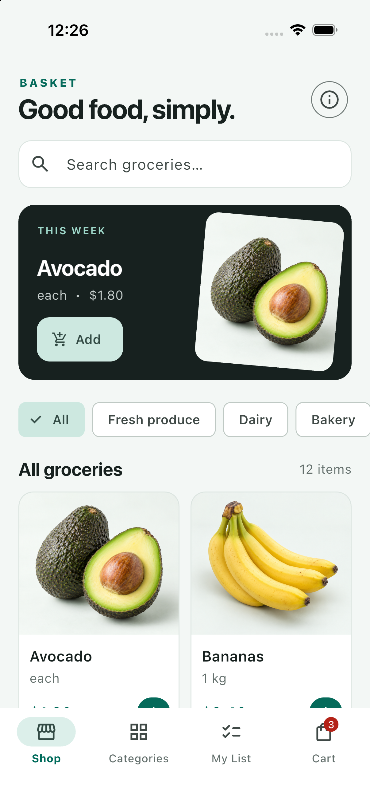
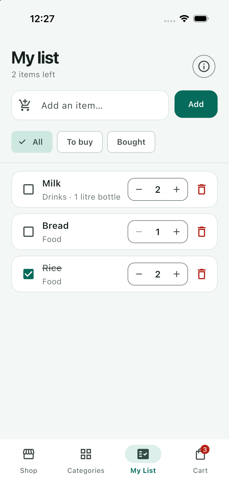
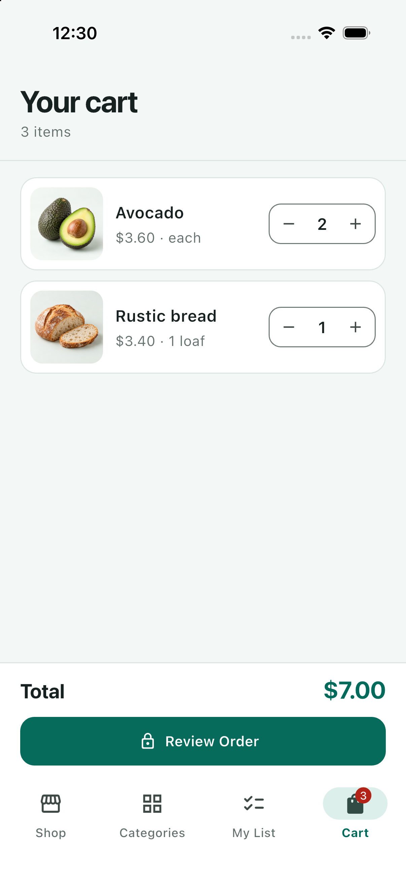
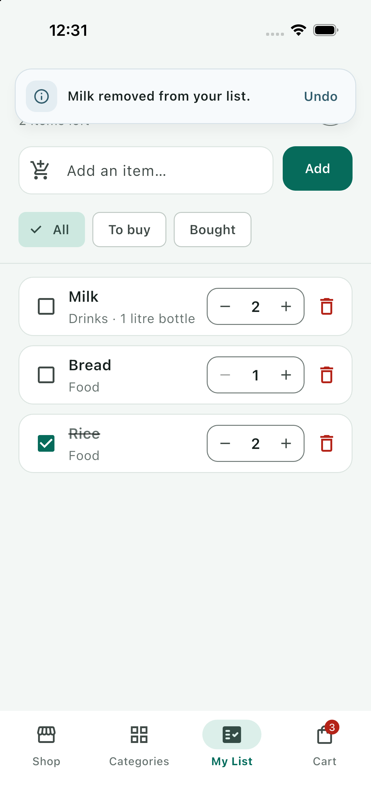

# Shopping List+

A complete, persistent Flutter shopping-list app built from the Week 2, Session 3 assignment brief. The project also includes a small grocery catalogue and cart to make the list feel at home in a real shopping app.

## Features

- Shows **Your list is empty** when the list has no items and **Nothing here** when only the current filter is empty.
- Gives every item a quantity stepper that starts at 1 and never goes below 1.
- Treats names case-insensitively and ignores surrounding spaces, so adding ` milk ` increases Milk's quantity instead of creating a duplicate.
- Deletes with an **Undo** action that restores the same item, position, quantity, and bought state.
- Filters by **All**, **To buy**, and **Bought**, with bought items kept at the bottom of All.
- Opens **Item details** on long-press, where the name, note, and Food/Drinks/Home category can be edited safely.
- Persists the list, quantities, bought status, notes, categories, catalogue cart, and cart quantities with SQLite.
- Completes checkout locally after confirmation and clears the persisted SQLite cart.
- Rolls optimistic changes back if a SQLite write fails, so the screen never lies about saved data.
- Uses compact floating top confirmations with clear status icons and Undo actions.
- Includes accessible labels, 44 px touch targets, keyboard submission, reduced-motion support, and responsive grocery grids.

## Screenshots

| Grocery catalogue | Shopping list |
| --- | --- |
|  |  |

| Persistent cart | Floating confirmation |
| --- | --- |
|  |  |

## Think

### 1. Why does deleting by `index` remove the wrong item when a filter is on? How was it fixed?

The filtered list is a different list. Its row 0 might refer to item 2 in the full list, so using the displayed row index against the full list can delete another item without causing an error. Each row now passes its actual `ShoppingItem` object to the delete method. The controller removes that object from the source list, independent of the active filter.

### 2. Why was `final` removed from `name`? Why is `final` still useful for most fields?

`final` allows a field to be assigned only once. The details screen must rename an existing item, so `name` has to be mutable. `final` is still the safer default for values whose identity should not change—such as an item's database `id`—because it prevents accidental reassignment and makes the model easier to reason about.

### 3. Why was a hot restart needed after adding `quantity` to `ShoppingItem`?

Hot reload updates methods and rebuilds widgets, but it does not recreate existing State objects or already-created model instances. Those objects were constructed before the new field and initializer existed. A hot restart rebuilds the Dart isolate and creates every object again with `quantity` initialized correctly.

### 4. Why did the list need `setState` after returning from details?

Changing a plain Dart object's fields does not automatically tell its widgets to rebuild. Flutter redraws when a listened-to state source notifies or when `setState` marks a widget subtree dirty. Returning from the details route is therefore the point where the original exercise calls `setState`. In this version, the shared `ShopController` also calls `notifyListeners`, and the shell rebuilds from that notification; the post-route `setState` keeps the screen correct even when it is used on its own.

## Run

```sh
flutter pub get
flutter run
```

To run the workshop's plain-Dart warm-up:

```sh
dart run warmup.dart
```

The SQLite database is created as `shopping_list.db` in the app's database directory.

## Documentation

- [Architecture and data flow](docs/ARCHITECTURE.md)
- [Requirements and acceptance checklist](docs/REQUIREMENTS.md)

## Verify

```sh
flutter analyze
flutter test
flutter build ios --simulator
```
